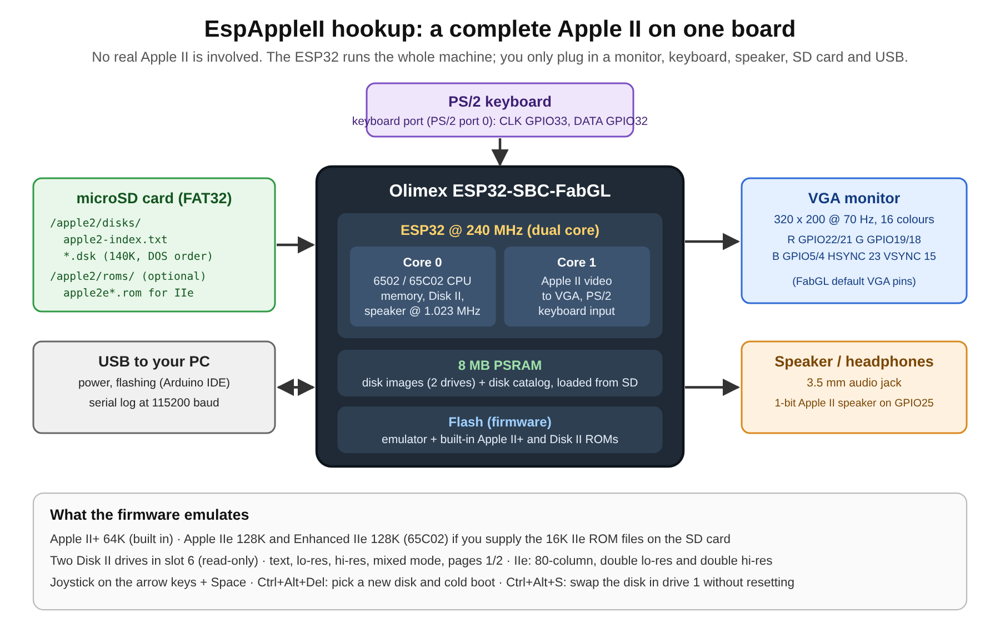

# EspAppleII: a standalone Apple II emulator for the ESP32



EspAppleII turns an **Olimex ESP32-SBC-FabGL** board into a complete, self-contained Apple II. The ESP32 emulates the Apple II's 6502 CPU, memory, video, Disk II drives, keyboard, joystick and speaker in software, and runs the real Apple II ROM code on top of that. You plug in a VGA monitor, a PS/2 keyboard, a speaker and a microSD card of disk images, and it boots DOS 3.3 and games like the real machine.

**It does not connect to a real Apple II.** There is no Apple II hardware anywhere in this setup, and the board is not a peripheral, card or display adapter for one. Everything the Apple II did is done by the firmware on the ESP32.

The project was originally created by Francisco J. A. Souza. The 6502 and Disk II sources were adapted from earlier emulator projects; their original authors should be credited when they are identified.

## What it emulates

| Area | Supported |
| --- | --- |
| Machines | Apple II+ 64K (built in, always available). Apple IIe 128K and Enhanced IIe 128K if you supply the IIe ROM files (see [Apple IIe 128K mode](#apple-iie-128k-mode)). |
| CPU | NMOS 6502 for the II+ and IIe; 65C02 for the Enhanced IIe. Paced to the original 1.023 MHz clock. |
| Memory | 48K main RAM plus a 16K language card. The IIe profiles add the 64K auxiliary bank and the `80STORE`, `RAMRD`, `RAMWRT`, `ALTZP` and internal-ROM soft switches. |
| Video | Text, low-resolution and high-resolution graphics, mixed text/graphics, pages 1 and 2. The IIe profiles add 80-column text, double low-res and double high-res. Output is 320×200 VGA at 70 Hz with a 16-colour Apple II palette. |
| Disks | Two Disk II drives in slot 6. Standard 140K DOS-order `.dsk` images, loaded from the SD card into PSRAM. Read-only. |
| Keyboard | PS/2 keyboard translated to Apple II key codes. |
| Joystick | Arrow keys drive the two paddle axes; **Space** is button 0. |
| Sound | The Apple II's 1-bit speaker, as a square wave on the board's audio jack. |

The Apple II+ system ROM (Applesoft BASIC and the Monitor, `$D000-$FFFF`) and the Disk II boot ROM (`$C600`) are compiled into the firmware in `memory.ino`. Apple IIe ROMs are not included.

## How it works

The ESP32 has two CPU cores, and the firmware gives each one a job:

- **Core 0** runs the emulated 6502/65C02. Every instruction reads and writes an emulated Apple II memory map, so touching a soft switch (video mode, speaker, disk drive, keyboard strobe) has the same effect it had on the real machine. Execution is throttled against the ESP32's microsecond timer so the CPU, speaker and disk rotation all run at Apple II speed.
- **Core 1** repeatedly redraws the Apple II screen from emulated video memory into the VGA framebuffer, and feeds PS/2 scancodes to the emulated keyboard.

At power-on the firmware initializes the board's 8 MB PSRAM, mounts the microSD card, reads the disk catalog, shows a disk selector on the VGA screen, and copies the chosen disk image into PSRAM. After that the emulator does not touch the SD card during normal disk access, so loading is fast and the card is never written.

Graphics, PS/2 input and SD-card access use the open-source [FabGL library](http://www.fabglib.org), in the Olimex fork for this board.

## Hardware and hookup

You need:

- **Olimex ESP32-SBC-FabGL** (ESP32 with 8 MB PSRAM, VGA, two PS/2 ports, audio jack, microSD slot and USB on one board)
- A monitor or TV with a VGA input
- A PS/2 keyboard (or a USB keyboard that supports PS/2 through a passive adapter)
- Powered speakers or headphones with a 3.5 mm plug
- A microSD card formatted FAT32
- A USB cable to a computer, for power, flashing and the serial log


Every connector is already on the board, so there is nothing to solder or wire. Plug things in like this:

| Connector on the board | Plug in | ESP32 pins used by the firmware |
| --- | --- | --- |
| VGA (DE-15) | Monitor | Red GPIO22/21, Green GPIO19/18, Blue GPIO5/4, HSync GPIO23, VSync GPIO15 (FabGL defaults) |
| PS/2 port 0 | Keyboard | CLK GPIO33, DATA GPIO32 (`PS2Preset::KeyboardPort0`) |
| PS/2 port 1 | Nothing (unused) | GPIO26/27 |
| 3.5 mm audio | Speakers or headphones | GPIO25 (`SPEAKER_PIN` in `speaker.ino`) |
| microSD slot | SD card with the `apple2` folder | FabGL `mountSDCard()` defaults: CS GPIO13, CLK GPIO14; MOSI/MISO are picked by FabGL for the board's ESP32 package |
| USB | Computer or USB power supply | Power, upload, and serial log at 115200 baud |

If the keyboard does nothing, it is probably in the other PS/2 port. The pin numbers are here for reference and for anyone porting to another FabGL-compatible board; check the Olimex schematic before relying on them for custom wiring.

## Building and flashing

The tested configuration is:

- ESP32 Arduino core **2.0.11**
- Olimex FabGL fork (reports FabGL **1.0.9**)
- Jack Christensen's Timer library
- Board **ESP32 Dev Module**, **240 MHz**, partition scheme **Huge APP**, PSRAM **Disabled**

### 1. Install Arduino IDE

Install [Arduino IDE 2](https://www.arduino.cc/en/software). This is a plain Arduino sketch; PlatformIO and ESP-IDF are not needed.

### 2. Install ESP32 Arduino core 2.0.11

1. Open **Tools → Board → Boards Manager**.
2. Search for `esp32` by Espressif Systems.
3. Install version **2.0.11**.

Do not use the 3.x core. FabGL and the runtime PSRAM setup depend on the 2.0.11 toolchain.

### 3. Install the Olimex FabGL fork

Use the [Olimex FabGL fork](https://github.com/OLIMEX/FabGL), not the Library Manager release.

1. Download the Olimex repository as a ZIP file.
2. Choose **Sketch → Include Library → Add .ZIP Library** and select the ZIP.
3. Restart Arduino IDE if the FabGL headers are not found.

Remove or rename any other FabGL installation first, or Arduino may compile against the wrong one.

### 4. Install the Timer library

Install Jack Christensen's [Timer library](https://github.com/JChristensen/Timer) the same way (**Add .ZIP Library**). It supplies `Timer.h`, `Timer.cpp`, `Event.h` and `Event.cpp` and drives the flashing text cursor. It is not the ESP32 hardware-timer API.

Everything else (SPI, PSRAM, FAT filesystem, file APIs) comes with the ESP32 core.

### 5. Configure the board

Select **Tools → Board → esp32 → ESP32 Dev Module**, then:

```text
CPU Frequency:     240MHz (WiFi/BT)
Partition Scheme:  Huge APP (3MB No OTA/1MB SPIFFS)
PSRAM:             Disabled
Upload Speed:      921600 (lower it if uploads are unreliable)
```

Leave PSRAM **disabled** in the IDE. The firmware turns on the board's PSRAM itself at startup, following Olimex's FabGL examples.

### 6. Compile and upload

Open `EspAppleII.ino` in the repository root, select the board's serial port, click **Verify**, then **Upload**. Open **Tools → Serial Monitor** at **115200 baud** to watch it boot.

If Arduino reports a missing header:

- `Timer.h`: install the Timer library.
- `fabgl.h`: install the Olimex FabGL fork and remove competing copies.
- ESP32 headers: check that core **2.0.11** and **ESP32 Dev Module** are selected.

## Preparing the SD card

Format a microSD card as FAT32 and create this layout:

```text
SD card root/
└── apple2/
    ├── roms/                      (optional, only for the IIe profiles)
    │   ├── apple2e.rom
    │   └── apple2e-enhanced.rom
    └── disks/
        ├── apple2-index.txt       (generated, required)
        ├── dos33.dsk
        ├── choplifter.dsk
        └── any/sub/folder/game.dsk
```

The `apple2/` folder in this repository holds a starter `dos33.dsk`.

Disk images must be standard DOS-order `.dsk` files of exactly **143,360 bytes**. `.po`, `.nib`, `.woz` and 2MG are not supported. Images are read-only, so saved games do not persist.

The firmware does not scan the SD card. It lists only the disks named in `apple2-index.txt`, which you generate on your computer:

```bash
python3 tools/build_disk_index.py "/path/to/apple2/disks"
```

Copy the whole `apple2` folder to the root of the card and insert it before powering the board. A missing or invalid index stops boot with **SD DISK ERROR** on screen. Up to 4,096 images can be indexed.

## Using it

On power-up a disk selector appears on the VGA screen.

| Key | In the disk selector |
| --- | --- |
| **Up / Down** | Move the selection |
| Type letters | Search by name (substring matches first, then fuzzy matches) |
| **Tab** | Cycle the machine: `APPLE II+ 64K`, `APPLE IIE 128K`, `ENHANCED IIE 128K` (profiles without a ROM are skipped) |
| **Enter** | Load the disk into drive 1 and boot |
| **Escape** | Jump back to the first entry, normally `dos33.dsk` |

| Key | While the emulator is running |
| --- | --- |
| **Ctrl+Alt+Delete** | Reopen the selector and cold-boot a new disk (the machine profile is kept) |
| **Ctrl+Alt+S** | Swap the disk in drive 1 without resetting, for "insert side 2" prompts. RAM, CPU state and video mode are preserved. |
| **Arrow keys** | Joystick X/Y (paddles 0 and 1) |
| **Space** | Joystick button 0 |

## Apple IIe 128K mode

Apple IIe ROMs are not distributed with this project. To enable the IIe profiles, put legally obtained, unmodified 16,384-byte ROM images on the SD card:

- `/apple2/roms/apple2e.rom` for **Apple IIe 128K** (NMOS 6502)
- `/apple2/roms/apple2e-enhanced.rom` for **Enhanced IIe 128K** (65C02)

Then press **Tab** in the disk selector to choose the profile.

## Debug and release builds

Normal builds are debug builds: they print serial diagnostics, short CPU and Disk II traces, and stack high-water marks every ten seconds. For a quiet release build, define `ESPAPPLEII_RELEASE=1`, for example with `arduino-cli`:

```bash
--build-property compiler.cpp.extra_flags=-DESPAPPLEII_RELEASE=1
```

Release mode only removes diagnostics; timing and behaviour are unchanged. Other build switches live in `build_config.h` (VGA palette test, double hi-res render mode).

A normal debug boot log starts like this:

```text
EspApple II Emulator (ESP32)
[MEM] Initializing onboard PSRAM for disk buffer...
[MEM] PSRAM initialized
[SD] Initializing ESP32-SBC-FabGL SD card...
...
[SD] Loaded choplifter.dsk into PSRAM (143360 bytes)
```

## Source layout

| File | What it does |
| --- | --- |
| `EspAppleII.ino` | Setup, VGA and PS/2 init, and the two FreeRTOS tasks (CPU on core 0, video and keyboard on core 1) |
| `cpu.ino` | 6502 and 65C02 instruction emulation |
| `memory.ino` | Apple II memory map, soft switches, language card, built-in II+ and Disk II ROMs |
| `machine.ino`, `machine.h` | II+ / IIe / Enhanced IIe profiles and IIe ROM loading |
| `video.ino`, `video.h`, `font.h` | Apple II text and graphics modes rendered to the VGA framebuffer |
| `disk.ino` | SD card, disk index, disk selector, PSRAM disk buffers, Disk II drive emulation |
| `keyboard.ino` | PS/2 scancode translation, joystick keys, Ctrl+Alt hot-keys |
| `speaker.ino` | 1-bit speaker on GPIO25 |
| `tools/build_disk_index.py` | Builds `apple2-index.txt` for the SD card |
| `docs/hookup-diagram.svg` | Source for the diagram at the top of this README |

## Known limitations

- Disk images are read-only; nothing is written back to the SD card.
- Only 140K DOS-order `.dsk` images are supported.
- Only the Disk II controller in slot 6 is emulated. There are no other expansion cards (printer, serial, mouse, Mockingboard).
- Some copy-protected software, or software that relies on unemulated hardware, may not run. Lode Runner was known not to work in the original project.

## Videos from the original project

- [DOS 3.3](https://www.youtube.com/watch?v=gkJJiDuz0lA)
- [Rescue Raiders](https://youtu.be/1CllMtIGst4)
- [Galaxian](https://youtu.be/dFom_zQjH2I)
- [Choplifter](https://youtu.be/LiarlgUO_FE)
- [CannonBall Blitz](https://youtu.be/a9vT981Lyd8)

## License

GNU GPL version 2 or later. See [LICENSE](LICENSE).

## Supporting the original author

The original author, Francisco J. A. Souza, is an independent developer. If you would like to buy him a beer or coffee, his Pix and PayPal address is `fj_souza@hotmail.com`.
